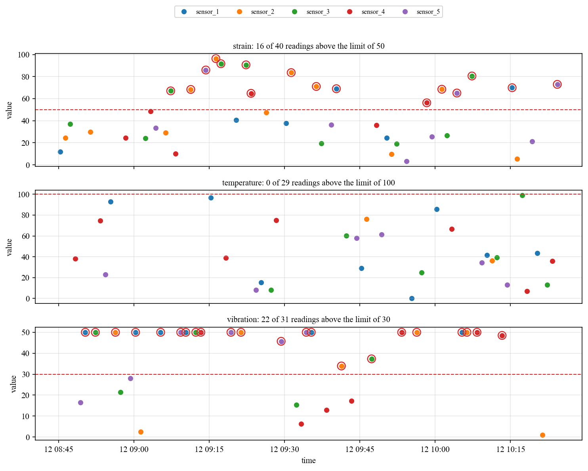
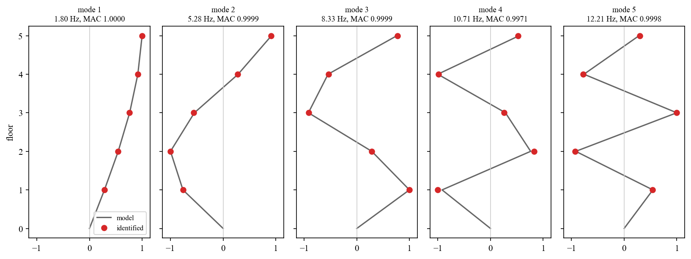
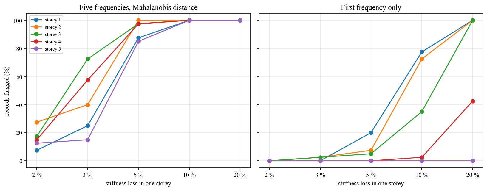
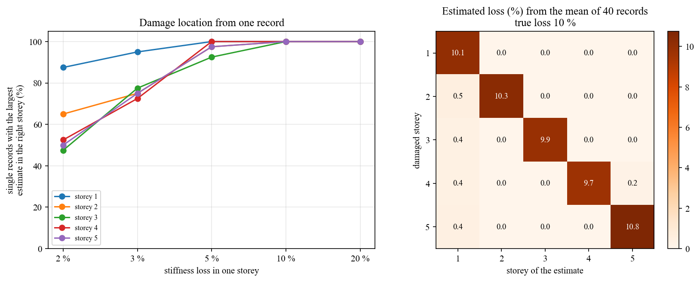

# Structural health monitoring: sensor-log checks and vibration-based damage detection

Python code in two parts. The first checks the sensor log that came with the first version of
this project. The second is a simulation study: can a loss of stiffness in one storey of a
five-storey frame be detected and located from floor accelerations recorded under ambient
excitation, when the temperature also changes the frequencies?

## The sensor log and its limits

`backend/data.csv` holds 100 readings, one per minute, from 08:45 to 10:24 on 12 January 2025:
five sensor ids, three sensor types (strain, temperature, vibration) and three places (Bridge A,
Building B, Tower C). The values have no units.

The checks show that the log is not a record of real instruments:

- every sensor id reports all three sensor types and all three places, so an id is not one
  instrument at one position;
- 18 of the 31 vibration readings are exactly 50, the largest vibration value in the file;
- 38 of the 100 readings are above the limit of their type (strain above 50: 16 of 40; vibration
  above 30: 22 of 31; temperature above 100: none of 29), so the limits do not separate rare
  events from ordinary readings;
- within each type no reading stands apart from the others: the largest robust score is 3.34,
  below the usual outlier limit of 3.5 (Iglewicz and Hoaglin, 1993).

The log is therefore treated as a practice file, and no conclusion about a structure is drawn
from it. The study below uses a model in which the true state is known.



## Method

**Sensor log** (`shm/log.py`): number of sensor types and places per sensor id, sampling
interval, readings equal to the maximum of their type, readings above the limit of their type,
and the modified z-score of each reading within its type.

**Frame study** (`shm/frame.py`, `shm/modal.py`):

1. **Model.** Five lumped floor masses of 50 t on storey springs of 80 MN/m, fixed at the base,
   with 2 % damping in every mode. Natural frequencies: 1.81, 5.29, 8.34, 10.71 and 12.22 Hz.
2. **Records.** Floor accelerations for 10 minutes at 50 Hz under independent white-noise forces
   on every floor. Each mode is advanced with its exact discrete-time solution. Measurement
   noise of 5 % of the signal is added to every channel.
3. **Temperature.** Between records the stiffness of the whole frame differs by up to 1.5 %,
   which moves every frequency by up to 0.75 %. A detector has to tell damage from this
   variation.
4. **Identification.** Frequency-domain decomposition (Brincker et al., 2001): the cross-spectral
   matrix of the five channels is decomposed at every spectral line; a peak of the first
   singular value gives a mode shape, and a fit to the lines around the peak gives the natural
   frequency and the damping ratio. Mode shapes are compared by the modal assurance criterion,
   MAC (Allemang and Brown, 1982).
5. **Detection.** Squared Mahalanobis distance of the five identified frequencies from 60 healthy
   records (Worden et al., 2000). The limit for a 1 % false-alarm rate comes from the F
   distribution for a new observation (Tracy et al., 1992). The same test with the first
   frequency alone is the comparison.
6. **Location.** To first order, the relative change of the squared frequency of a mode equals
   minus the sum over the storeys of (stiffness loss x share of the modal strain energy in that
   storey) (Cawley and Adams, 1979). The storey losses are found from the five frequency changes
   by non-negative least squares.
7. **Cases.** Stiffness losses of 2, 3, 5, 10 and 20 % in each of the five storeys, 40 records
   per case, and 200 further healthy records for the false-alarm rate.

## Results

Produced by `python run_analysis.py`, which takes about one minute; all tables are in
[results/summary.md](results/summary.md).

### Identification

From one record the five frequencies are within 0.44 % of the model values, the damping ratios
are between 1.9 and 2.7 % (true value 2 %), and the MAC of every mode shape is at least 0.997.

|                                               | Mode 1 | Mode 2 | Mode 3 | Mode 4 | Mode 5 |
| --------------------------------------------- | ------ | ------ | ------ | ------ | ------ |
| Model frequency (Hz)                          | 1.812  | 5.289  | 8.338  | 10.711 | 12.217 |
| Identified from one record (Hz)               | 1.804  | 5.283  | 8.329  | 10.711 | 12.212 |
| Scatter over 60 records, constant temperature | 0.22 % | 0.15 % | 0.11 % | 0.11 % | 0.10 % |
| Scatter over 60 records, varying temperature  | 0.51 % | 0.49 % | 0.48 % | 0.45 % | 0.47 % |

A 10 % stiffness loss in one storey lowers a frequency by 0.14 to 1.95 %, depending on the
storey and the mode ([all values](reports/visualizations/frequency_changes.png)). The scatter
caused by the temperature, about 0.5 %, is as large as the largest frequency change that a loss
of 2 to 3 % in one storey causes.



### Detection

On the 200 further healthy records both detectors give 0.5 % false alarms (1 % intended). Share
of the 40 records flagged, as the range over the five damaged storeys:

| Stiffness loss | Five frequencies | First frequency only |
| -------------- | ---------------- | -------------------- |
| 2 %            | 8 to 28 %        | 0 %                  |
| 3 %            | 15 to 72 %       | 0 to 2 %             |
| 5 %            | 85 to 100 %      | 0 to 20 %            |
| 10 %           | 100 %            | 0 to 78 %            |
| 20 %           | 100 %            | 0 to 100 %           |

- With five frequencies a 5 % loss is flagged in at least 85 % of the records and a 10 % loss in
  all of them, in every storey. A change of temperature moves all frequencies together, and the
  Mahalanobis distance allows for that direction; damage in one storey changes the frequencies
  in a different pattern.
- The first frequency alone flags at most 20 % of the records at a 5 % loss. It never flags
  damage in the top storey, not even a 20 % loss: the top storey holds little of the strain
  energy of the first mode, and a 10 % loss there lowers the first frequency by 0.16 %.
- Below 5 % the result depends on the storey: a 3 % loss is flagged in 72 % of the records when
  it is in storey 3 and in 15 % when it is in storey 5.



### Location

Share of single records in which the largest estimated loss is in the damaged storey: 48 to
88 % at a 2 % loss, 72 to 95 % at 3 %, 92 to 100 % at 5 %, and 100 % at 10 and 20 %.

From the mean frequencies of the 40 records of a case:

| True loss | Estimated loss in the damaged storey | Largest estimate in another storey |
| --------- | ------------------------------------ | ---------------------------------- |
| 2 %       | 1.7 to 2.2 %                         | 0.6 %                              |
| 3 %       | 2.7 to 3.0 %                         | 0.3 %                              |
| 5 %       | 4.5 to 5.2 %                         | 0.6 %                              |
| 10 %      | 9.7 to 10.8 %                        | 0.5 %                              |
| 20 %      | 19.0 to 21.8 %                       | 2.8 %                              |

The estimates at 20 % are less accurate because the relation used is a first-order one.



Other figures: [singular-value spectrum of one record](reports/visualizations/fdd_spectrum.png),
[novelty index of every record](reports/visualizations/novelty_index.png),
[sensor types and places per sensor id](reports/visualizations/log_metadata.png).

## Running

```bash
pip install -r requirements.txt
python run_analysis.py                  # reports/visualizations/, results/, backend/anomalies.csv
python -m unittest discover -s tests    # 24 checks
```

| Option       | Default            | Meaning                                                                          |
| ------------ | ------------------ | -------------------------------------------------------------------------------- |
| `--log`      | `backend/data.csv` | sensor log with the columns `sensor_id, value, timestamp, sensor_type, location` |
| `--seed`     | 1                  | seed of the simulated records                                                    |
| `--baseline` | 60                 | healthy records used to set the limits                                           |
| `--healthy`  | 200                | further healthy records for the false-alarm rate                                 |
| `--damaged`  | 40                 | records per damage case                                                          |

## Layout

```
shm/frame.py       shear-frame model: modes, strain-energy shares, response to floor forces
shm/modal.py       spectral matrix, frequency-domain decomposition, damage location, novelty detector
shm/log.py         checks of the sensor log
run_analysis.py    full analysis, figures and result tables
tests/             unit tests against closed-form results, random-vibration theory and synthetic data
backend/           the sensor log and its readings above the limits
legacy/            the original script
```

## Changes from the first version

- The original script (`legacy/data_opertaion.py`) drew a line through the readings of each
  sensor id, one comparison plot and one "anomalies" plot per id. An id mixes three sensor types
  and three places, so such a line has no meaning. Those eleven plots are replaced by
  `log_readings.png`, which groups the readings by sensor type.
- Its anomaly plots applied the limit of an id's first reading to all readings of that id and
  marked 29 readings. With the limit of each reading's own type the number is 38. That is also
  what `backend/anomalies.csv` of the first version lists, and the new code reproduces that file
  exactly.
- The frame study is new.

## Limits

- The frame, the excitation and the temperature effect are a model. The results show what the
  methods can resolve under the stated noise and variability, not how they perform on a real
  building.
- Temperature is represented by one factor on the stiffness of the whole frame. In a real
  structure the environmental effects are not uniform.
- Only the frequencies are used for detection and location. The mode shapes are identified, but
  they serve only to track the modes from record to record.
- Damage is a stiffness loss of a whole storey in a linear structure.
- Tracking the modes needs reference frequencies and shapes; here they are those of the model.

## References

- Allemang, R. J., and Brown, D. L. (1982). A correlation coefficient for modal vector analysis.
  Proceedings of the 1st International Modal Analysis Conference, 110-116.
- Brincker, R., Zhang, L., and Andersen, P. (2001). Modal identification of output-only systems
  using frequency domain decomposition. Smart Materials and Structures, 10(3), 441-445.
- Cawley, P., and Adams, R. D. (1979). The location of defects in structures from measurements
  of natural frequencies. Journal of Strain Analysis, 14(2), 49-57.
- Iglewicz, B., and Hoaglin, D. C. (1993). How to Detect and Handle Outliers. ASQC Quality Press.
- Tracy, N. D., Young, J. C., and Mason, R. L. (1992). Multivariate control charts for individual
  observations. Journal of Quality Technology, 24(2), 88-95.
- Worden, K., Manson, G., and Fieller, N. R. J. (2000). Damage detection using outlier analysis.
  Journal of Sound and Vibration, 229(3), 647-667.

## Author

Bibek Subedi, 078bce035.bibek@pcampus.edu.np
